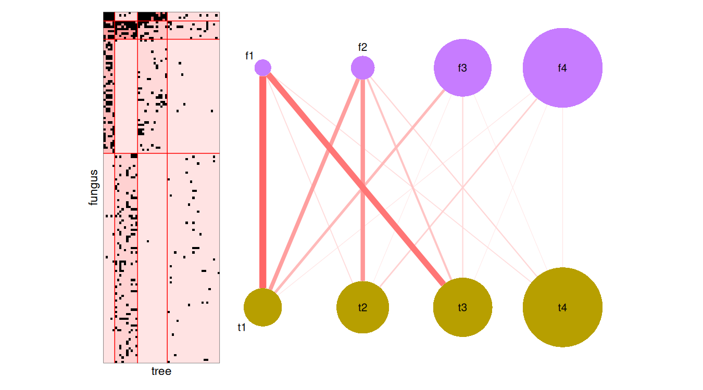

<!-- README.md is generated from README.Rmd. Please edit that file -->

# sbm: Stochastic Blockmodels

<!-- badges: start -->

[](https://CRAN.R-project.org/package=sbm)
[](https://github.com/GrossSBM/sbm/actions/workflows/check-standard.yaml)
[](https://grosssbm.github.io/sbm/)
[](https://app.codecov.io/gh/GrossSBM/sbm?branch=master)
[](https://lifecycle.r-lib.org/articles/stages.html#stable)
<!-- badges: end -->

**sbm** gathers in a single framework the tools to simulate, estimate
and represent a variety of **stochastic block models** (SBM), a family
of models that cluster the nodes of a network into blocks sharing the
same connectivity patterns.

## Supported models

| Network                                           | Function                    | Estimation engine                                             |
|---------------------------------------------------|-----------------------------|---------------------------------------------------------------|
| Simple (one set of nodes, directed or not)        | `estimateSimpleSBM()`       | [blockmodels](https://CRAN.R-project.org/package=blockmodels) |
| Bipartite (two sets of nodes)                     | `estimateBipartiteSBM()`    | [blockmodels](https://CRAN.R-project.org/package=blockmodels) |
| Multipartite (several sets of nodes and networks) | `estimateMultipartiteSBM()` | [GREMLINS](https://CRAN.R-project.org/package=GREMLINS)       |
| Multiplex (several networks on the same nodes)    | `estimateMultiplexSBM()`    | GREMLINS (independent layers), blockmodels (dependent layers) |

- **Emission distributions** on the edges: Bernoulli (binary networks),
  Poisson (counts) and Gaussian (weights).
- **Covariates**, for simple and bipartite SBM: on the **edges**, acting
  on the connectivity, or on the **nodes**, driving the block
  memberships.
- **Missing values** (`NA`) in the networks: the missing dyads are
  ignored in the inference (see the help pages for the details of each
  model).
- **Model selection** of the number of blocks with the Integrated
  Classification Likelihood (ICL).
- **Graphics** with ggplot2: reordered matrices, expected networks,
  graphons, mesoscopic views and alluvial plots.
- **Simulation** of networks with `sampleSimpleSBM()`,
  `sampleBipartiteSBM()`, `sampleMultipartiteSBM()` and
  `sampleMultiplexSBM()`.

## Installation

The stable version is available on
[CRAN](https://CRAN.R-project.org/package=sbm):

``` r
install.packages("sbm")
```

The development version can be installed from
[GitHub](https://github.com/GrossSBM/sbm):

``` r
# install.packages("pak")
pak::pak("GrossSBM/sbm")
```

## Example

The data set `fungusTreeNetwork` records the interactions between 154
fungal species and 51 tree species. A bipartite SBM groups the fungi and
the trees into blocks sharing the same interaction patterns, the number
of blocks being chosen with the ICL.

``` r
library(sbm)
data("fungusTreeNetwork")
fungusTree <- fungusTreeNetwork$fungus_tree

fit <- estimateBipartiteSBM(
  fungusTree, model = "bernoulli", dimLabels = c(row = "fungus", col = "tree"),
  estimOptions = list(verbosity = 0, plot = FALSE, nbCores = 1)
)
```

``` r
fit$nbBlocks
#> fungus   tree 
#>      4      4
```

``` r
library(patchwork)
plot(fit, type = "data") + plot(fit, type = "meso")
```



The [vignettes](https://grosssbm.github.io/sbm/articles/) go further:
model principles, case studies on simple, bipartite, multipartite and
multiplex networks, and covariates on the nodes.

## Related packages

- [blockmodels](https://CRAN.R-project.org/package=blockmodels):
  estimation of simple and bipartite SBM (and of dependent multiplex
  SBM), used by **sbm**.
- [GREMLINS](https://CRAN.R-project.org/package=GREMLINS): estimation of
  multipartite SBM, used by **sbm**.
- [missSBM](https://CRAN.R-project.org/package=missSBM): SBM for
  networks with missing data, under various sampling designs (missing at
  random or not).
- [shinySbm](https://CRAN.R-project.org/package=shinySbm): a Shiny
  application to fit SBM with **sbm**.

## References

- Léger, J.-B. (2016). Blockmodels: A R-package for estimating in Latent
  Block Model and Stochastic Block Model, with various probability
  functions, with or without covariates.
  [arXiv:1602.07587](https://doi.org/10.48550/arXiv.1602.07587).
- Barbillon, P., Donnet, S., Lazega, E. and Bar-Hen, A. (2017).
  Stochastic block models for multiplex networks: an application to a
  multilevel network of researchers. *Journal of the Royal Statistical
  Society: Series A*, 180(1), 295–314.
  [doi:10.1111/rssa.12193](https://doi.org/10.1111/rssa.12193).
- Bar-Hen, A., Barbillon, P. and Donnet, S. (2022). Block models for
  generalized multipartite networks: Applications in ecology and
  ethnobiology. *Statistical Modelling*, 22(4), 273–296.
  [doi:10.1177/1471082X20963254](https://doi.org/10.1177/1471082X20963254).
