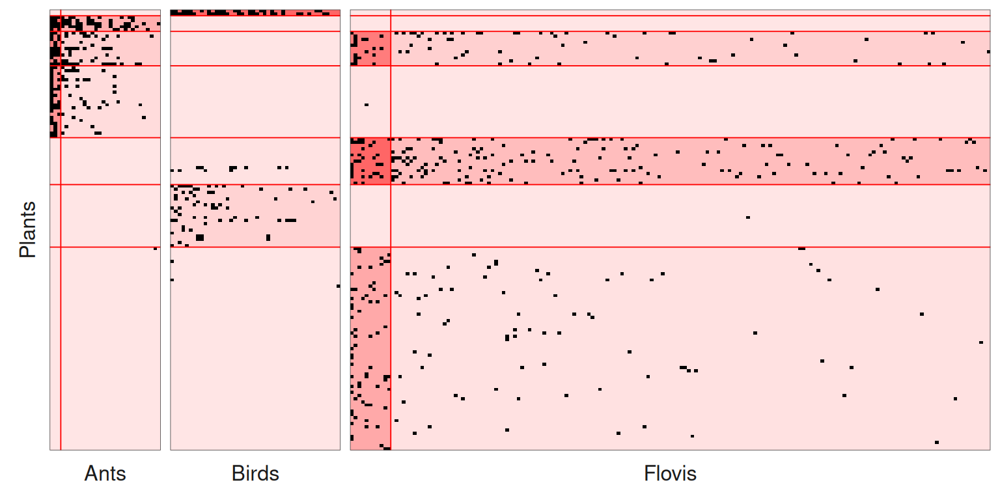

# Multipartite Stochastic Block Models

## 1. Preliminaries

This vignette illustrates the use of the `estimateMultipartiteSBM`
function and the methods accompanying the R6 class
`MultipartiteSBM_fit`.

The only package required for the analysis is **sbm**:

``` r

library(sbm)
```

## 2. Dataset

### 2.1 Description of the data

We apply our methodology to an ecological mutualistic multipartite
network. The dataset –compiled and conducted by Dáttilo et al.
([2016](#ref-Dattilo)) at Centro de Investigaciones Costeras La Mancha
(CICOLMA), located on the central coast of the Gulf of Mexico, Veracruz,
Mexico– involves three general types of plant-animal mutualistic
interaction: pollination, seed dispersal by frugivorous birds, and
protective mutualisms between ants and plants with extrafloral
nectaries.

The dataset –which is one of the largest compiled so far with respect to
species richness, number of interactions and sampling effort– includes 4
functional groups (FG), namely plants, pollinator species (referred as
floral visitors), ant species and frugivorous bird species. Three binary
bipartite networks have been collected representing interactions between
1/ plants and florals visitor, 2/ plants and ants, and 3/ plants and
seed dispersal birds, resulting into three bipartite networks.

The FG are of respective sizes: $`n_1 = 141`$ plant species,
$`n_2 = 173`$ pollinator species, $`n_3 = 46`$ frugivorous bird species
and $`n_4 = 30`$ ant species.

The 3 networks contain $`753`$ observed interactions of which $`55\%`$
are plant-pollinator interactions, $`17\%`$ are plant-birds interactions
and $`28\%`$ are plant-ant interactions.

``` r

data(multipartiteEcologicalNetwork)
str(multipartiteEcologicalNetwork)
#> List of 3
#>  $ Inc_plant_ant   : int [1:141, 1:30] 0 1 0 0 1 0 1 0 1 0 ...
#>   ..- attr(*, "dimnames")=List of 2
#>   .. ..$ : chr [1:141] "Acacia_cornigera" "Acacia_macracantha" "Achatocarpus_nigricans" "Agave_angustifolia" ...
#>   .. ..$ : chr [1:30] "Camponotus_planatus" "Camponotus_mucronatus" "Paratrechina_longicornis_" "Crematogaster_brevispinosa" ...
#>  $ Inc_plant_bird  : int [1:141, 1:46] 0 0 1 0 0 0 0 0 0 0 ...
#>   ..- attr(*, "dimnames")=List of 2
#>   .. ..$ : chr [1:141] "Acacia_cornigera" "Acacia_macracantha" "Achatocarpus_nigricans" "Agave_angustifolia" ...
#>   .. ..$ : chr [1:46] "Cyanocorax_morio" "Tyrannus_forficatus" "Ortalis_vetula" "Myiozetetes_similis" ...
#>  $ Inc_plant_flovis: int [1:141, 1:173] 0 0 0 0 0 0 0 1 1 0 ...
#>   ..- attr(*, "dimnames")=List of 2
#>   .. ..$ : chr [1:141] "Acacia_cornigera" "Acacia_macracantha" "Achatocarpus_nigricans" "Agave_angustifolia" ...
#>   .. ..$ : chr [1:173] "Apis_melifera" "Lasioglossum_sp1" "Trigona_nigra" "Ascia_monuste" ...
names(multipartiteEcologicalNetwork)
#> [1] "Inc_plant_ant"    "Inc_plant_bird"   "Inc_plant_flovis"
```

### 2.2 Formatting the data

We format the data to be able to use our functions, i.e. we transform
each matrix into an object containing *the matrix*, *its type*
(`bipartite` for an incidence matrix, `simple` for an adjacency matrix,
which can be directed or not), the model and the names of the functional
groups in row and in column.

To do so, we use the function `defineSBM`.

``` r

Net <- multipartiteEcologicalNetwork
type = "bipartite"
model = "bernoulli"
directed = FALSE
PlantFlovis <- defineSBM(Net$Inc_plant_flovis, model, type, directed, dimLabels = c("Plants",
    "Flovis"))
PlantAnt <- defineSBM(Net$Inc_plant_ant, model, type, directed, dimLabels = c("Plants",
    "Ants"))
PlantBird <- defineSBM(Net$Inc_plant_bird, model, type, directed, dimLabels = c("Plants",
    "Birds"))
```

If one wants to keep a track of the names of the species, they should be
used as rownames and colnames in the matrices.

``` r

PlantFlovis$networkData[1:2, 1:2]
#>                    Apis_melifera Lasioglossum_sp1
#> Acacia_cornigera               0                1
#> Acacia_macracantha             0                0
```

A plot of the data can be obtained with the following command:

``` r

plotMyMultipartiteMatrix(list(PlantFlovis, PlantAnt, PlantBird))
```


## 3. Multipartite SBM

### 3.1 Mathematical background

See Bar-Hen et al. ([2022](#ref-multipartite)) for details.

### 3.2 Inference

The model selection and the estimation are performed with the function
`estimateMultipartiteSBM`.

``` r

estimOptions = list(initBM = FALSE)
listSBM <- list(PlantFlovis, PlantAnt, PlantBird)
myMSBM <- estimateMultipartiteSBM(listSBM, estimOptions)
```

`myMSBM` contains the estimated parameters of the models we run through
during the search of the better numbers of blocks.

``` r

myMSBM
#> Fit of a Multipartite Stochastic Block Model 
#> 4 parts/functional groups ( Plants Flovis Ants Birds ),  3 networks
#> =====================================================================
#> nbNodes per FG = ( 141 173 30 46 ) --  nbBlocks per FG = ( 7 2 2 1 )
#> distributions on each network:  bernoulli bernoulli bernoulli 
#> =====================================================================
#> * Useful fields 
#>   $nbNetwork, $nbNodes, $nbBlocks, $dimLabels, $architecture 
#>   $modelName, $blockProp, $connectParam, $memberships, $networkData
#>   $probMemberships, $loglik, $ICL, $storedModels, 
#> * R6 and S3 methods 
#>   plot, print, coef, predict, fitted, $setModel, $reorder 
#>   $probMemberships, $loglik, $ICL, $storedModels, 
#> * R6 and S3 methods 
#>   plot, print, coef, predict, fitted, $setModel, $reorder
```

The best model has the following numbers of blocks:

``` r

myMSBM$nbBlocks
#> Plants Flovis   Ants  Birds 
#>      7      2      2      1
```

To see the parameters estimated for the better model we use the
following command `myMSBM$connectParam` or `myMSBM$blockProp`:

``` r

myMSBM$blockProp
#> $Plants
#> [1] 0.01418720 0.03802305 0.07840873 0.16063183 0.10614897 0.13507513 0.46752510
#> 
#> $Flovis
#> [1] 0.06221568 0.93778432
#> 
#> $Ants
#> [1] 0.1014381 0.8985619
#> 
#> $Birds
#> [1] 1
myMSBM$connectParam
#> [[1]]
#> [[1]]$mean
#>              [,1]         [,2]
#> [1,] 2.464664e-15 4.440892e-16
#> [2,] 1.001131e-15 4.440892e-16
#> [3,] 1.651832e-01 3.427940e-02
#> [4,] 4.173707e-03 8.566580e-08
#> [5,] 1.917898e-01 6.378749e-02
#> [6,] 8.826487e-07 3.317267e-04
#> [7,] 9.573240e-02 7.490241e-03
#> 
#> 
#> [[2]]
#> [[2]]$mean
#>              [,1]         [,2]
#> [1,] 5.366301e-15 1.107167e-15
#> [2,] 8.491907e-01 3.564830e-01
#> [3,] 6.620266e-01 1.542027e-01
#> [4,] 5.430946e-01 5.891885e-02
#> [5,] 7.172257e-16 4.440892e-16
#> [6,] 5.721732e-16 4.440892e-16
#> [7,] 4.440892e-16 5.576222e-04
#> 
#> 
#> [[3]]
#> [[3]]$mean
#>              [,1]
#> [1,] 5.108074e-01
#> [2,] 4.440892e-16
#> [3,] 4.440892e-16
#> [4,] 4.440892e-16
#> [5,] 1.625224e-02
#> [6,] 7.534085e-02
#> [7,] 1.253527e-03
```

The clusterings supplied by the better model are in
`myMSBM$memberships$***`.

``` r

table(myMSBM$memberships$Plants)
#> 
#>  1  2  3  4  5  6  7 
#>  2  5 11 23 15 20 65
table(myMSBM$memberships$Ants)
#> 
#>  1  2 
#>  3 27
```

``` r

myMSBM$storedModels
#>   indexModel nbParams nbBlocks Plants nbBlocks Flovis nbBlocks Ants
#> 1          1       43               7               2             2
#> 2          2       37               6               2             2
#> 3          3       31               5               2             2
#> 4          4       25               5               2             1
#> 5          5       19               5               1             1
#> 6          6       15               4               1             1
#> 7          7       11               3               1             1
#> 8          8        7               2               1             1
#> 9          9        3               1               1             1
#>   nbBlocks Birds nbBlocks       ICL    loglik
#> 1              1       12 -2961.903 -2770.230
#> 2              1       11 -2965.539 -2800.546
#> 3              1       10 -2981.164 -2840.532
#> 4              1        9 -3017.651 -2897.765
#> 5              1        8 -3071.369 -2984.442
#> 6              1        7 -3128.286 -3057.690
#> 7              1        6 -3216.136 -3161.801
#> 8              1        5 -3358.851 -3326.480
#> 9              1        4 -3582.348 -3568.733
```

## 4. Plots

We can either plot the reorganized matrices, the background of each
block being colored according to its density:

``` r

plot(myMSBM)
```



the expected connections:

``` r

plot(myMSBM, type = "expected")
```


or the mesoscopic view, where each block is a node and each connectivity
an edge. The functional groups are distinguished by the colors of the
nodes, and the labels of the blocks start with the name of their
functional group (`P` for plants, `F` for floral visitors…). Within each
functional group, the area of the nodes is proportional to the block
proportions. The width and the color of the edges grow with the
probability of connection between the blocks. The blocks are placed
according to their connections (blocks strongly connected are close),
whatever their functional group; this layout being random, it is fixed
with the option `seed`.

``` r

plot(myMSBM, type = "meso", plotOptions = list(seed = 1))
```


Many connectivities are close to zero. They can be removed with
`edge.threshold`, which makes the structure clearer: the plants of
blocks 2, 3 and 4 interact with the ants, the plants of blocks 3, 5 and
7 with the floral visitors, and the plants of blocks 1 and 6 with the
birds.

``` r

plot(myMSBM, type = "meso", plotOptions = list(seed = 1, edge.threshold = 0.05))
```


The blocks can also be arranged with one row per functional group
(`layout = "groups"`), and the colors of the functional groups chosen
with `vertex.color`:

``` r

plot(myMSBM, type = "meso",
     plotOptions = list(layout = "groups", edge.threshold = 0.05,
                        vertex.color = c("darkolivegreen3", "darkgoldenrod2", "mediumpurple2", "cadetblue2")))
```


Finally, the coordinates of the blocks are returned in the attribute
`blockLayout` of the plot. They can be modified (here, the block F2 is
moved next to F1) and given back with the option `layout`:

``` r

g <- plot(myMSBM, type = "meso", plotOptions = list(seed = 1, edge.threshold = 0.05))
myLayout <- attr(g, "blockLayout")
head(myLayout)
#>           x          y
#> P1 4.950862 -2.8378181
#> P2 3.839142  0.8090767
#> P3 2.242557 -0.4697098
#> P4 1.851337  0.8328752
#> P5 1.480221 -2.9666574
#> P6 5.693049 -0.4781445
myLayout["F2", ] <- myLayout["F1", ] - c(1, 0)
plot(myMSBM, type = "meso", plotOptions = list(layout = myLayout, edge.threshold = 0.05))
```


All the options are described in
[`?plot.SBM`](https://grosssbm.github.io/sbm/reference/plot.SBM.md).

## References

Bar-Hen, Avner, Pierre Barbillon, and Sophie Donnet. 2022. “Block Models
for Generalized Multipartite Networks: Applications in Ecology and
Ethnobiology.” *Statistical Modelling* 22 (4): 273–96.
<https://doi.org/10.1177/1471082X20963254>.

Dáttilo, Wesley, Nubia Lara-Rodrı́guez, Pedro Jordano, et al. 2016.
“Unravelling Darwin’s Entangled Bank: Architecture and Robustness of
Mutualistic Networks with Multiple Interaction Types.” *Proceedings of
the Royal Society of London B: Biological Sciences* 283 (1843).
