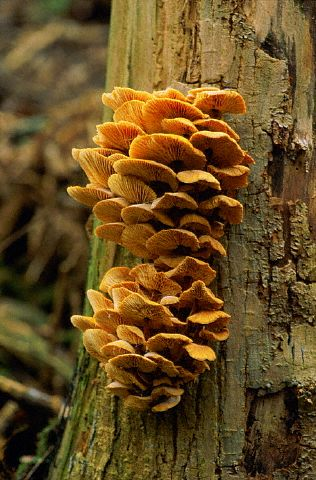

# Simple and Bipartite Stochastic Block Models



*Flammulina velutipes*, photo by Kork, license [CC BY
3.0](https://creativecommons.org/licenses/by/3.0/)

## 1. Preliminaries

This vignette illustrates the use of the `estimateSBM` function and the
methods accompanying the R6 classes `SimpleSBMfit` and
`BipartiteSBMfit`.

### 1.1 Requirements

The packages required for the analysis are obviously **sbm** plus some
others for data manipulation and representation:

``` r

library(sbm)
library(ggplot2)
library(knitr)
library(patchwork) # to put figures side by side
```

To display the composition of the clusters, we use the following
function, which gives a table with the names of the nodes of each
cluster in a column:

``` r

clusterComposition <- function(memberships, nodeNames) {
  clusters <- split(nodeNames, factor(memberships, levels = 1:max(memberships)))
  maxSize  <- max(lengths(clusters))
  tab <- sapply(clusters, function(x) c(x, rep("", maxSize - length(x))))
  colnames(tab) <- paste("Cluster", seq_along(clusters))
  as.data.frame(tab)
}
```

### 1.2 Data set: antagonistic tree/fungus interaction network

We consider the fungus-tree interaction network studied by Vacher et al.
([2008](#ref-tree_fungus_network)), available with the package **sbm**:

``` r

data("fungusTreeNetwork")
str(fungusTreeNetwork, max.level = 1)
#> List of 5
#>  $ tree_names  : Factor w/ 51 levels "Abies alba","Abies grandis",..: 1 2 3 14 42 4 5 6 7 8 ...
#>  $ fungus_names: Factor w/ 154 levels "Amphiporthe leiphaemia",..: 1 2 3 4 5 6 7 8 9 10 ...
#>  $ tree_tree   : num [1:51, 1:51] 0 12 9 3 2 2 0 0 2 7 ...
#>  $ fungus_tree : int [1:154, 1:51] 0 0 0 0 1 1 1 0 0 0 ...
#>  $ covar_tree  :List of 3
```

This data set provides information about 154 fungi sampled on 51 tree
species. It is a list with the following entries:

- `fungus_names`: list of the fungus species names
- `tree_names` : list of the tree species names
- `fungus_tree` : binary fungus-tree interactions
- `tree_tree` : weighted tree-tree interactions (number of common fungal
  species two tree species host)
- `covar_tree` : covariates associated to pairs of trees (namely
  genetic, taxonomic and geographic distances)

We first consider the tree-tree interactions resulting into a Simple
Network. Then we consider the bipartite network between trees and fungi.

### 1.3 Mathematical Background

In all the models, each node $`i`$ belongs to a latent block $`Z_i`$,
and the edges are independent given the blocks, with a distribution
depending only on the blocks of the nodes they involve. The model fitted
in each section is recalled before the fit. The parameters are estimated
with a variational EM algorithm, and the number of blocks is selected
with the Integrated Classification Likelihood (ICL). See Leger
([2016](#ref-blockmodels)) and Jean-Benoist Leger
([2015](#ref-legervacher)) for details.

## 2. Analysis of the tree/tree data

### 2.1 Tree-tree binary interaction networks

We first consider the binary network where an edge is drawn between two
trees when they do share a least one common fungi:

Some names are long. For trees, the species of the group are given in
parentheses (for instance “Cultivated Poplars (Populus trichocarpa, P.
canescens, P.alba, P.nigra and their cultivated hybrids)”). For fungi,
some names give the grouped species in parentheses (for instance
“Botrytis cinerea (grouped with Botryotinia fuckeliana (anamorphic
type))”) or a variety or special form (for instance “Coleosporium
tussilaginis f.sp. senecionis-silvatici”). To keep the plots and tables
readable, we only keep the part before the parentheses, and the genus
and species for fungi: the short names still identify each tree and each
fungus.

``` r

treeNames   <- trimws(sub("\\(.*", "", fungusTreeNetwork$tree_names))
fungusNames <- trimws(sub(" (var\\.|f\\.sp\\.) .*", "", sub("\\(.*", "", fungusTreeNetwork$fungus_names)))
tree_tree_binary <- 1 * (fungusTreeNetwork$tree_tree != 0)
colnames(tree_tree_binary) <- rownames(tree_tree_binary) <- treeNames
```

The simple function `plotMyMatrix` can be use to represent simple or
bipartite SBM:

``` r

plotMyMatrix(tree_tree_binary, dimLabels =c('tree'))
```


We look for some latent structure of the network by adjusting a simple
SBM with the function `estimateSimpleSBM`.

> **The Bernoulli SBM**
>
> The $`n`$ trees are divided into $`Q`$ blocks, with proportions
> $`\pi = (\pi_1, \dots, \pi_Q)`$, and $`Y_{ij} = 1`$ if trees $`i`$ and
> $`j`$ share at least one fungus. The network being undirected,
> $`Y_{ij} = Y_{ji}`$ and the model is defined for $`i < j`$:
> ``` math
> \begin{align*}
>  (Z_i)_{i} \text{ i.i.d.} \qquad & \mathbb{P}(Z_i = q) = \pi_q, \\
>  (Y_{ij})_{i<j} \text{ indep.} \mid (Z_i)_{i} \qquad & Y_{ij} \mid Z_i = q, Z_j = l \sim \mathcal{B}ern(\alpha_{ql}),
> \end{align*}
> ```
> with $`\alpha_{ql} = \alpha_{lq}`$ the probability of connection
> between a tree of block $`q`$ and a tree of block $`l`$.

``` r

mySimpleSBM <- tree_tree_binary %>% 
  estimateSimpleSBM("bernoulli", dimLabels = 'tree', estimOptions = list(verbosity = 0, plot = FALSE))
```

Once fitted, the user can manipulate the fitted model by accessing the
various fields and methods enjoyed by the class `simpleSBMfit`. Most
important fields and methods are recalled to the user via the `show`
method:

``` r

class(mySimpleSBM)
#> [1] "SimpleSBM_fit" "SimpleSBM"     "SBM"           "R6"
mySimpleSBM
#> Fit of a Simple Stochastic Block Model -- bernoulli variant
#> =====================================================================
#> Dimension = ( 51 ) - ( 5 ) blocks.  No  edge covariate(s). No  node covariate(s). 
#> =====================================================================
#> * Useful fields 
#>   $nbNodes, $modelName, $dimLabels, $nbBlocks, $nbCovariates, $nbDyads
#>   $blockProp, $connectParam, $covarParam, $covarList, $covarEffect 
#>   $nbNodesCovariates, $nodesCovariates, $nodesCovariatesParam 
#>   $expectation, $indMemberships, $memberships 
#> * R6 and S3 methods 
#>   $rNetwork, $rMemberships, $rEdges, plot(obj), print(obj), coef(obj) 
#> * Additional fields
#>   $probMemberships, $loglik, $ICL, $storedModels, 
#> * Additional methods 
#>   predict, fitted, $setModel, $reorder
```

For instance,

``` r

mySimpleSBM$nbBlocks
#> [1] 5
mySimpleSBM$nbNodes
#> tree 
#>   51
mySimpleSBM$nbCovariates
#> [1] 0
```

The plot method is available as a S3 or R6 method. The default
represents the network data reordered according to the memberships
estimated in the SBM. The red lines separate the blocks, and the
background of each block is colored with an opacity growing with the
mean value of the entries of the block: in the Bernoulli model, it is
the estimated probability of connection $`\widehat{\alpha}_{ql}`$
between the blocks $`q`$ and $`l`$.

The estimated connectivity can also be represented alone, as a graphon:
each block is represented by an interval of $`[0,1]`$ whose length is
its estimated proportion $`\widehat{\pi}_q`$, and the square
$`q \times l`$ is colored according to $`\widehat{\alpha}_{ql}`$, with
the same colors as the background of the data plot. We put the two plots
side by side with the package **patchwork**.

``` r

plot(mySimpleSBM, type = "data", plotOptions = list(rowNames = TRUE, colNames = TRUE)) |
  plot(mySimpleSBM, type = "graphon")
```


The parameters of the graphon can be displayed as follows:

``` r

coef(mySimpleSBM, 'block')
#> [1] 0.3320954 0.1766383 0.1378665 0.1766999 0.1766999
coef(mySimpleSBM, 'connectivity')
#> $mean
#>            [,1]      [,2]       [,3]       [,4]       [,5]
#> [1,] 0.98230909 0.9828930 0.92749023 0.60851311 0.05994511
#> [2,] 0.98289303 0.9937459 0.29390960 0.91904879 0.22617761
#> [3,] 0.92749023 0.2939096 0.79890626 0.05802394 0.02169247
#> [4,] 0.60851311 0.9190488 0.05802394 0.47209785 0.06626655
#> [5,] 0.05994511 0.2261776 0.02169247 0.06626655 0.02899357
```

#### About model selection and choice of the number of blocks

During the estimation, a certain range of models are explored
corresponding to different number of blocks. By default, the best model
in terms of Integrated Classification Likelihood is sent back. In fact,
all the model are stored internally. The user can have a quick glance at
them via the `$storedModels` field:

``` r

mySimpleSBM$storedModels %>% kable()
```

| indexModel | nbParams | nbBlocks |       ICL |    loglik |
|-----------:|---------:|---------:|----------:|----------:|
|          1 |        1 |        1 | -883.3334 | -879.7581 |
|          2 |        4 |        2 | -619.0799 | -606.3880 |
|          3 |        8 |        3 | -537.5179 | -512.1339 |
|          4 |       13 |        4 | -540.6318 | -498.9806 |
|          5 |       19 |        5 | -520.6645 | -459.1706 |
|          6 |       26 |        6 | -530.6278 | -445.7159 |
|          7 |       34 |        7 | -544.0191 | -432.1138 |
|          8 |       43 |        8 | -562.1450 | -419.6710 |

We can then see what models are competitive in terms of model selection
by checking the ICL:

``` r

mySimpleSBM$storedModels %>%  ggplot() + aes(x = nbBlocks, y = ICL)  + geom_line() + geom_point(alpha = 0.5)
```


The 4-block or 6-block model could have been a “reasonable” choice too,
in place of the 5-block model. The user can update the current
`simpleSBMfit` thanks to the `setModel`.

We use it to compare the clusterings obtained with 4, 5 and 6 blocks
with an alluvial plot (function `plotAlluvial`): each vertical axis
represents a clustering, and the stripes show how the trees move from
one cluster to another. The stripes are colored according to the
clusters of the first clustering, which shows how the clusters split
when the number of blocks increases.

``` r

clust_5blocks <-mySimpleSBM$memberships
mySimpleSBM$setModel(4)
clust_4blocks <-mySimpleSBM$memberships
mySimpleSBM$setModel(6)
clust_6blocks <-mySimpleSBM$memberships
mySimpleSBM$setModel(5)
plotAlluvial(list('4 blocks'=clust_4blocks,'5 blocks'=clust_5blocks,'6 blocks'=clust_6blocks))
```


We observe that going from 4 blocks to 5 blocks roughly divides block 1
into two clusters. Similarly, going from 5 blocks to 6 blocks, roughly
divides block 4 into two smaller blocks.

### 2.2 Analysis of the weighted interaction network

Instead of considering the binary network tree-tree we may consider the
weighted network where the link between two trees is the number of fungi
they share.

We plot the matrix with function `plotMyMatrix`:

``` r

tree_tree <- fungusTreeNetwork$tree_tree
colnames(tree_tree) <- rownames(tree_tree) <- treeNames
plotMyMatrix(tree_tree, dimLabels = c('tree'))
```


Here again, we look for some latent structure of the network by
adjusting a simple SBM with the function `estimateSimpleSBM`,
considering a Poisson distribution on the edges.

> **The Poisson SBM**
>
> $`Y_{ij}`$ is now the number of fungi shared by trees $`i`$ and $`j`$.
> The blocks are defined as before, and
> ``` math
> \begin{align*}
>  (Z_i)_{i} \text{ i.i.d.} \qquad & \mathbb{P}(Z_i = q) = \pi_q, \\
>  (Y_{ij})_{i<j} \text{ indep.} \mid (Z_i)_{i} \qquad & Y_{ij} \mid Z_i = q, Z_j = l \sim \mathcal{P}(\lambda_{ql}),
> \end{align*}
> ```
> with $`\lambda_{ql} = \lambda_{lq}`$ the mean number of fungi shared
> by a tree of block $`q`$ and a tree of block $`l`$.

``` r

mySimpleSBMPoisson <- tree_tree %>% 
  estimateSimpleSBM("poisson", dimLabels = 'tree', estimOptions = list(verbosity = 0, plot = FALSE))
```

Once fitted, the user can manipulate the fitted model by accessing the
various fields and methods enjoyed by the class `simpleSBMfit`. Most
important fields and methods are recalled to the user via the `show`
method:

``` r

class(mySimpleSBMPoisson)
#> [1] "SimpleSBM_fit" "SimpleSBM"     "SBM"           "R6"
mySimpleSBMPoisson
#> Fit of a Simple Stochastic Block Model -- poisson variant
#> =====================================================================
#> Dimension = ( 51 ) - ( 6 ) blocks.  No  edge covariate(s). No  node covariate(s). 
#> =====================================================================
#> * Useful fields 
#>   $nbNodes, $modelName, $dimLabels, $nbBlocks, $nbCovariates, $nbDyads
#>   $blockProp, $connectParam, $covarParam, $covarList, $covarEffect 
#>   $nbNodesCovariates, $nodesCovariates, $nodesCovariatesParam 
#>   $expectation, $indMemberships, $memberships 
#> * R6 and S3 methods 
#>   $rNetwork, $rMemberships, $rEdges, plot(obj), print(obj), coef(obj) 
#> * Additional fields
#>   $probMemberships, $loglik, $ICL, $storedModels, 
#> * Additional methods 
#>   predict, fitted, $setModel, $reorder
```

For instance,

``` r

mySimpleSBMPoisson$nbBlocks
#> [1] 6
mySimpleSBMPoisson$nbNodes
#> tree 
#>   51
mySimpleSBMPoisson$nbCovariates
#> [1] 0
```

We now plot the matrix reordered according to the memberships estimated
in the SBM, next to the corresponding graphon. The entries are now
counts, represented in gray levels, and the background of each block
corresponds to the estimated mean number of shared fungi
$`\widehat{\lambda}_{ql}`$ between the blocks $`q`$ and $`l`$.

``` r

plot(mySimpleSBMPoisson, type = "data", plotOptions = list(rowNames = TRUE, colNames = TRUE)) |
  plot(mySimpleSBMPoisson, type = "graphon")
```


The graphon can also be drawn as a network, in a mesoscopic view: each
block is a node whose area is proportional to the block proportion
$`\widehat{\pi}_q`$, and the mean number of shared fungi
$`\widehat{\lambda}_{ql}`$ between two blocks is represented by an edge
whose width and color grow with $`\widehat{\lambda}_{ql}`$, with the
same colors as the graphon. The connectivity within a block,
$`\widehat{\lambda}_{qq}`$, is represented by a loop. The layout being
random, it is fixed with the option `seed`.

``` r

plot(mySimpleSBMPoisson, type = "meso", plotOptions = list(seed = 1))
```


The composition of the clusters can now be scrutinized:

``` r

kable(clusterComposition(mySimpleSBMPoisson$memberships, treeNames),
      caption = "Tree clusters (Poisson SBM)")
```

| Cluster 1 | Cluster 2 | Cluster 3 | Cluster 4 | Cluster 5 | Cluster 6 |
|:---|:---|:---|:---|:---|:---|
| Abies alba | Large Maples | Abies nordmanniana | Small Maples | Cupressus sempervirens | Betulus spp |
| Abies grandis | Fagus silvatica | Larix kaempferi | Alnus glutinosa | Pinus brutia | Carpinus betulus |
| Cedrus spp | Fraxinus spp | Picea sitchensis | Castanea sativa | Pinus cembra | Populus tremula |
| Larix decidua | Juglans spp | Pinus halepensis | Quercus ilex | Pinus pinea | Quercus pyrenaica |
| Picea excelsa | Cultivated Poplars | Pinus nigra nigra | Quercus pubescens | Pinus radiata | Sorbus aucuparia |
| Pinus nigra laricio | Prunus avium | Pinus strobus | Quercus suber | Pinus taeda | Sorbus domestica |
| Pinus pinaster | Quercus petraea | Pinus uncinata | Sorbus aria | Platanus hybrida | Taxus baccata |
| Pinus sylvestris | Quercus robur |  | Tilia spp | Tsuga heterophylla | Thuja plicata |
| Pseudotsuga menziesii | Quercus rubra |  |  |  | Ulmus spp |
|  | Sorbus torminalis |  |  |  |  |

Tree clusters (Poisson SBM) {.table .caption-top}

#### Comparison of the binary and weighted clusterings

We compare the clusterings obtained on the binary network (Bernoulli
SBM) and on the weighted network (Poisson SBM) with an alluvial plot,
the stripes being colored according to the clusters of the Bernoulli
SBM.

``` r

plotAlluvial(list(Bernoulli = mySimpleSBM$memberships,
                  Poisson   = mySimpleSBMPoisson$memberships))
```


The most connected cluster of the Bernoulli SBM is cluster 1: its 17
trees share at least one fungus with 37 other trees on average (out of
50), and the probability of connection within the cluster is
$`\widehat{\alpha}_{1 1} =`$ 0.98. In the binary network, these trees
are almost all connected to each other, so the network cannot
distinguish them any further. The weighted network, which counts the
shared fungi, reveals a finer structure: this cluster is split by the
Poisson SBM into

- 9 trees (Poisson cluster 1) sharing on average $`\widehat{\lambda} =`$
  9 fungi with each other: Abies alba, Abies grandis, Cedrus spp, Larix
  decidua, Picea excelsa, Pinus nigra laricio, Pinus pinaster, Pinus
  sylvestris, Pseudotsuga menziesii;
- 5 trees (Poisson cluster 3) sharing fewer fungi with each other
  ($`\widehat{\lambda} =`$ 3.9): Abies nordmanniana, Larix kaempferi,
  Picea sitchensis, Pinus nigra nigra, Pinus uncinata;
- and 3 trees moving to other clusters: Juglans spp, Sorbus aria, Pinus
  brutia.

Both main parts are made of conifers: the binary network gathers the
conifers, and the weighted network separates those sharing many fungi
from those sharing fewer.

### 2.3 Introduction of covariates

We have on each pair of trees 3 covariates, namely the genetic distance,
the taxonomic distance and the geographic distance. Each covariate has
to be introduced as a matrix: $`X^k_{ij}`$ corresponds to the value of
the $`k`$-th covariate describing the couple $`(i,j)`$.

> **The Poisson SBM with covariates on the edges**
>
> Let $`x_{ij} = (X^1_{ij}, \dots, X^p_{ij})^\top \in \mathbb{R}^p`$ be
> the vector of the $`p = 3`$ covariates of the pair $`(i,j)`$. The
> covariates act on the mean of the edges, through a regression
> parameter $`\beta \in \mathbb{R}^p`$ common to all the pairs:
> ``` math
> \begin{align*}
>  (Z_i)_{i} \text{ i.i.d.} \qquad & \mathbb{P}(Z_i = q) = \pi_q, \\
>  (Y_{ij})_{i<j} \text{ indep.} \mid (Z_i)_{i} \qquad & Y_{ij} \mid Z_i = q, Z_j = l \sim \mathcal{P}\left(\lambda_{ql} \exp(x_{ij}^\top \beta)\right).
> \end{align*}
> ```
> The blocks now capture the structure of the network which is not
> explained by the covariates.

``` r

mySimpleSBMCov<- 
  tree_tree %>% 
  estimateSimpleSBM(
    model = 'poisson', 
    directed = FALSE, 
    dimLabels = 'tree',
    covariates  = fungusTreeNetwork$covar_tree, 
    estimOptions = list(verbosity = 0, plot = FALSE, nbCores = 2)
  )
```

- We select the best number of clusters (with respect to the ICL
  criteria)

``` r

mySimpleSBMCov$nbBlocks
#> [1] 4
```

- We can now extract the parameters of interest, namely ($`\lambda`$,
  $`\pi`$) and the clustering of the nodes.

``` r

mySimpleSBMCov$connectParam
#> $mean
#>           [,1]       [,2]      [,3]      [,4]
#> [1,] 28.207064 14.8964888 5.9617522 1.2396157
#> [2,] 14.896489  9.5664171 3.7941904 0.4110826
#> [3,]  5.961752  3.7941904 1.6183797 0.3842726
#> [4,]  1.239616  0.4110826 0.3842726 0.1893782
mySimpleSBMCov$blockProp
#> [1] 0.3715916 0.2159544 0.2354116 0.1770425
mySimpleSBMCov$memberships
#>  [1] 1 1 2 1 2 2 4 4 2 1 3 1 1 1 1 2 1 2 3 3 2 1 2 1 3 3 2 1 3 2 3 1 4 1 1 3 1 3
#> [39] 4 1 1 3 2 4 4 1 4 4 3 3 4
mySimpleSBMCov$covarParam
#>            [,1]
#> [1,]  0.1975175
#> [2,] -2.0552576
#> [3,] -0.3586006
```

``` r

coef(mySimpleSBMCov, 'covariates')
#>            [,1]
#> [1,]  0.1975175
#> [2,] -2.0552576
#> [3,] -0.3586006
```

S3 methods are also available for fit and prediction (results hidden
here)

``` r

#fitted(mySimpleSBMCov)
#predict(mySimpleSBMCov)
#predict(mySimpleSBMCov, fungusTreeNetwork$covar_tree)
```

## 3. Analysis of the tree/fungi data

We now analyze the bipartite tree/fungi interactions. The incidence
matrix `fungus_tree` has the fungi in rows and the trees in columns. To
get a wide plot, we put the trees in rows and the fungi in columns by
transposing it: the bipartite SBM treats rows and columns in the same
way, so this does not change the model. The incidence matrix can be
plotted with the function `plotMyMatrix`:

``` r

tree_fungus <- t(fungusTreeNetwork$fungus_tree)
rownames(tree_fungus) <- treeNames
colnames(tree_fungus) <- fungusNames
plotMyMatrix(tree_fungus, dimLabels = c(row = 'tree', col = 'fungis'))
```


> **The bipartite SBM**
>
> The $`n_1`$ trees (in rows) are divided into $`Q_1`$ blocks with
> proportions $`\pi^1`$, and the $`n_2`$ fungi (in columns) into $`Q_2`$
> blocks with proportions $`\pi^2`$. $`Y_{ij} = 1`$ if fungus $`j`$ was
> observed on tree $`i`$, and
> ``` math
> \begin{align*}
>  (Z^1_i)_{i} \text{ i.i.d.} \qquad & \mathbb{P}(Z^1_i = q) = \pi^1_q, \\
>  (Z^2_j)_{j} \text{ i.i.d.}, \text{ indep. of } (Z^1_i)_{i} \qquad & \mathbb{P}(Z^2_j = r) = \pi^2_r, \\
>  (Y_{ij})_{i,j} \text{ indep.} \mid (Z^1_i)_{i}, (Z^2_j)_{j} \qquad & Y_{ij} \mid Z^1_i = q, Z^2_j = r \sim \mathcal{B}ern(\alpha_{qr}),
> \end{align*}
> ```
> with $`\alpha_{qr}`$ the probability that a fungus of block $`r`$ is
> observed on a tree of block $`q`$.

The model is fitted with the function `estimateBipartiteSBM`:

``` r

myBipartiteSBM <- 
  tree_fungus %>% 
  estimateBipartiteSBM(model = 'bernoulli', dimLabels = c('tree', 'fungis'), estimOptions = list(verbosity = 0, plot = FALSE))
```

``` r

myBipartiteSBM$nbNodes
#>   tree fungis 
#>     51    154
myBipartiteSBM$nbBlocks
#>   tree fungis 
#>      4      4
myBipartiteSBM$connectParam
#> $mean
#>            [,1]      [,2]        [,3]        [,4]
#> [1,] 0.96798282 0.5281051 0.327457450 0.020134849
#> [2,] 0.07714501 0.5896776 0.003883283 0.155064928
#> [3,] 0.84173863 0.2393528 0.099918358 0.001333581
#> [4,] 0.06797475 0.1119710 0.005829596 0.019186990
coef(myBipartiteSBM, 'block')
#> $tree
#> [1] 0.1034934 0.1956584 0.2489919 0.4518563
#> 
#> $fungis
#> [1] 0.02655516 0.05376727 0.31487519 0.60480238
coef(myBipartiteSBM, 'connectivity')
#> $mean
#>            [,1]      [,2]        [,3]        [,4]
#> [1,] 0.96798282 0.5281051 0.327457450 0.020134849
#> [2,] 0.07714501 0.5896776 0.003883283 0.155064928
#> [3,] 0.84173863 0.2393528 0.099918358 0.001333581
#> [4,] 0.06797475 0.1119710 0.005829596 0.019186990
```

We can now plot the reorganized matrix (top). The row blocks (trees) and
the column blocks (fungi) are separated by the red lines, the background
of each block representing the estimated probability of connection
$`\widehat{\alpha}_{qr}`$ between the tree block $`q`$ and the fungus
block $`r`$. As in the simple case, the estimated connectivity can be
represented as a graphon (bottom), the row and column blocks being sized
by their estimated proportions. The plots being wide, we put them one
above the other with **patchwork**.

``` r

plot(myBipartiteSBM, type = "data") / plot(myBipartiteSBM, type = "graphon")
```


In the mesoscopic view of a bipartite SBM, the blocks of trees (on top)
and the blocks of fungi (at the bottom) are drawn with different colors,
and each edge represents the probability of connection
$`\widehat{\alpha}_{qr}`$ between a block of trees and a block of fungi:

``` r

plot(myBipartiteSBM, type = "meso")
```


The clusters of trees are:

``` r

kable(clusterComposition(myBipartiteSBM$memberships$tree, rownames(tree_fungus)),
      caption = "Tree clusters (bipartite SBM)")
```

| Cluster 1 | Cluster 2 | Cluster 3 | Cluster 4 |
|:---|:---|:---|:---|
| Picea excelsa | Large Maples | Abies alba | Small Maples |
| Pinus nigra laricio | Castanea sativa | Abies grandis | Alnus glutinosa |
| Pinus pinaster | Fagus silvatica | Abies nordmanniana | Betulus spp |
| Pinus sylvestris | Fraxinus spp | Cedrus spp | Carpinus betulus |
| Pseudotsuga menziesii | Juglans spp | Larix decidua | Cupressus sempervirens |
|  | Cultivated Poplars | Larix kaempferi | Pinus brutia |
|  | Prunus avium | Picea sitchensis | Pinus cembra |
|  | Quercus petraea | Pinus halepensis | Pinus radiata |
|  | Quercus robur | Pinus nigra nigra | Platanus hybrida |
|  | Quercus rubra | Pinus pinea | Populus tremula |
|  |  | Pinus strobus | Quercus ilex |
|  |  | Pinus taeda | Quercus pubescens |
|  |  | Pinus uncinata | Quercus pyrenaica |
|  |  |  | Quercus suber |
|  |  |  | Sorbus aria |
|  |  |  | Sorbus aucuparia |
|  |  |  | Sorbus domestica |
|  |  |  | Sorbus torminalis |
|  |  |  | Taxus baccata |
|  |  |  | Thuja plicata |
|  |  |  | Tilia spp |
|  |  |  | Tsuga heterophylla |
|  |  |  | Ulmus spp |

Tree clusters (bipartite SBM) {.table .caption-top}

and the clusters of fungi are:

``` r

kable(clusterComposition(myBipartiteSBM$memberships$fungis, colnames(tree_fungus)),
      caption = "Fungus clusters (bipartite SBM)")
```

| Cluster 1 | Cluster 2 | Cluster 3 | Cluster 4 |
|:---|:---|:---|:---|
| Armillaria ostoyae | Armillaria gallica | Armillaria cepistipes | Amphiporthe leiphaemia |
| Heterobasidion annosum | Armillaria mellea | Caliciopsis pinea | Apiognomonia errabunda |
| Sphaeropsis sapinea | Botrytis cinerea | Cenangium ferruginosum | Apiognomonia veneta |
| Sydowia polyspora | Botryosphaeria stevensii | Ceratocystis ips | Asteroma tiliae |
|  | Fomitopsis pinicola | Ceratocystis minor | Biscogniauxia mediterranea |
|  | Haematonectria haematococca | Chrysomyxa abietis | Bjerkandera adusta |
|  | Ophiostoma piceae | Chrysomyxa ledi | Blumeriella jaapii |
|  | Phaeolus schweinitzii | Coleosporium tussilaginis | Botryosphaeria dothidea |
|  |  | Cronartium flaccidum | Ceratocystis platani |
|  |  | Cronartium ribicola | Chondrostereum purpureum |
|  |  | Crumenulopsis sororia | Colpoma quercinum |
|  |  | Cyclaneusma minus | Cristulariella depraedans |
|  |  | Cyclaneusma niveum | Cronartium quercuum |
|  |  | Cylindrocarpon didymum | Cryptodiaporthe castanea |
|  |  | Delphinella abietis | Cryptostroma corticale |
|  |  | Gremmeniella abietina | Cryptodiaporthe hystrix |
|  |  | Herpotrichia juniperi | Cryphonectria parasitica |
|  |  | Lachnellula willkommii | Cryptodiaporthe populea |
|  |  | Leptographium lundbergii | Daedaleopsis confragosa |
|  |  | Leptographium procerum | Dicarpella dryina |
|  |  | Lirula macrospora | Discella castanea |
|  |  | Lirula nervisequia | Drepanopeziza punctiformis |
|  |  | Lophodermium conigenum | Entoleuca mammata |
|  |  | Lophodermium piceae | Eutypa lata |
|  |  | Lophodermium pinastri | Fistulina hepatica |
|  |  | Lophodermium seditiosum | Fomes fomentarius |
|  |  | Melampsorella caryophyllacearum | Fomitopsis cytisina |
|  |  | Melampsora populnea | Fusarium oxysporum |
|  |  | Mycosphaerella pini | Fusicoccum quercus |
|  |  | Nectria fuckeliana | Ganoderma adspersum |
|  |  | Ophiostoma serpens | Ganoderma applanatum |
|  |  | Pestalotiopsis funerea | Ganoderma resinaceum |
|  |  | Phacidium coniferarum | Gnomonia leptostyla |
|  |  | Phaeocryptopus gaeumannii | Gymnopus fusipes |
|  |  | Phellinus chrysoloma | Hypoxylon fragiforme |
|  |  | Phellinus hartigii | Laetiporus sulphureus |
|  |  | Phellinus pini | Leucostoma persoonii |
|  |  | Pucciniastrum epilobii | Melampsora allii-populina |
|  |  | Rhabdocline pseudotsugae | Melampsora laricis-populina |
|  |  | Rhizosphaera kalkhoffii | Melanconis modonia |
|  |  | Rhizosphaera macrospora | Meripilus giganteus |
|  |  | Rhizosphaera oudemansii | Microsphaera alphitoides |
|  |  | Rhizina undulata | Microstroma juglandis |
|  |  | Sarea resinae | Monochaetia monochaeta |
|  |  | Sirococcus strobilinus | Mycosphaerella castaneicola |
|  |  | Sparassis crispa | Mycosphaerella dearnessii |
|  |  | Stereum sanguinolentum | Mycosphaerella microsora |
|  |  | Truncatella hartigii | Nectria cinnabarina |
|  |  | Valsa kunzei | Nectria coccinea |
|  |  | Zythiostroma pinastri | Nectria ditissima |
|  |  |  | Nectria veuillotiana |
|  |  |  | Neonectria galligena |
|  |  |  | Ophiostoma ulmi |
|  |  |  | Oudemansiella mucida |
|  |  |  | Oxyporus populinus |
|  |  |  | Pezicula cinnamomea |
|  |  |  | Phellinus igniarius |
|  |  |  | Phellinus robustus |
|  |  |  | Phloeospora aceris |
|  |  |  | Phomopsis juniperivora |
|  |  |  | Phomopsis quercella |
|  |  |  | Phyllosticta aceris |
|  |  |  | Phyllactinia guttata |
|  |  |  | Pleurotus ostreatus |
|  |  |  | Pleuroceras pseudoplatani |
|  |  |  | Podosphaera clandestina |
|  |  |  | Pollaccia radiosa |
|  |  |  | Polyporus squamosus |
|  |  |  | Pseudoinonotus dryadeus |
|  |  |  | Rhytisma acerinum |
|  |  |  | Rosellinia necatrix |
|  |  |  | Sawadaea tulasnei |
|  |  |  | Schizophyllum commune |
|  |  |  | Seiridium cardinale |
|  |  |  | Septotis podophyllina |
|  |  |  | Septoria quercicola |
|  |  |  | Stegonsporium pyriforme |
|  |  |  | Stereum hirsutum |
|  |  |  | Stigmina carpophila |
|  |  |  | Taphrina betulina |
|  |  |  | Taphrina caerulescens |
|  |  |  | Taphrina cerasi |
|  |  |  | Taphrina populina |
|  |  |  | Titaeosporina tremulae |
|  |  |  | Trametes gibbosa |
|  |  |  | Trametes versicolor |
|  |  |  | Valsa ambiens |
|  |  |  | Valsa nivea |
|  |  |  | Valsa sordida |
|  |  |  | Venturia fraxini |
|  |  |  | Venturia inaequalis |
|  |  |  | Verticillium dahliae |

Fungus clusters (bipartite SBM) {.table .caption-top
style="width:100%;"}

## References

Jean-Benoist Leger, Corinne Vacher, Jean-Jacques Daudin. 2015.
“Clustering Methods Differ in Their Ability to Detect Patterns in
Ecological Networks.” *Methods in Ecology and Evolution*.

Leger, Jean-Benoist. 2016. “Blockmodels: A r-Package for Estimating in
Latent Block Model and Stochastic Block Model, with Various Probability
Functions, with or Without Covariates.” *arXiv Preprint
arXiv:1602.07587*.

Vacher, Corinne, Dominique Piou, and Marie-Laure Desprez-Loustau. 2008.
“Architecture of an Antagonistic Tree/Fungus Network: The Asymmetric
Influence of Past Evolutionary History.” *PloS One* 3 (3): e1740.
