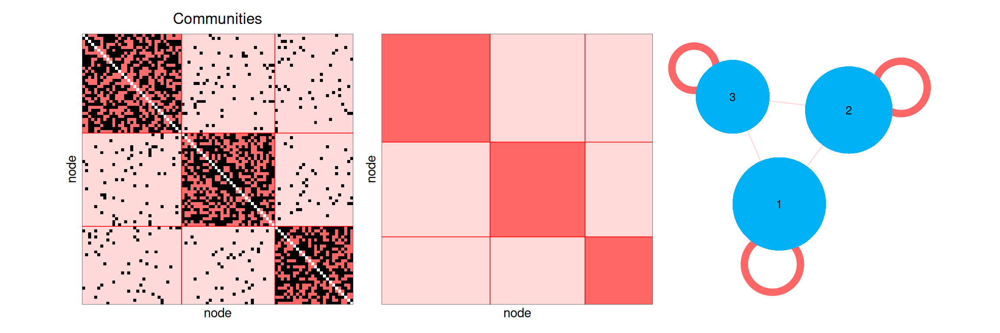
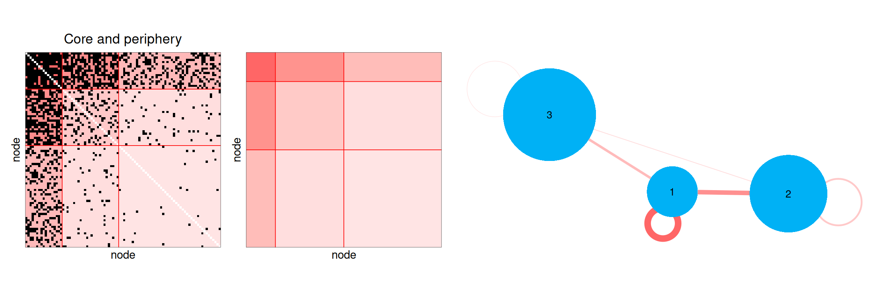
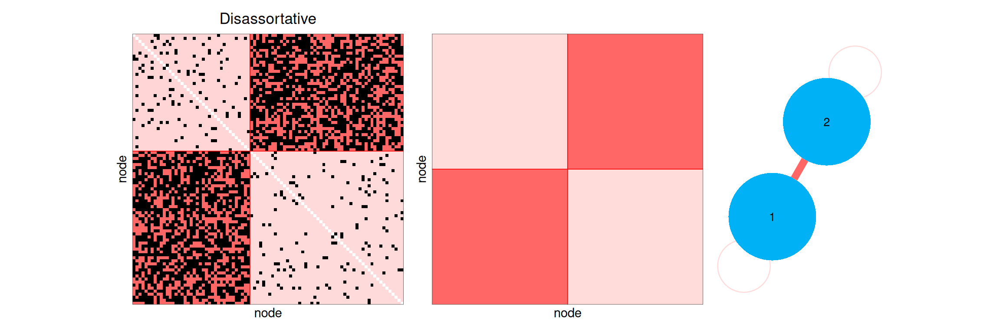
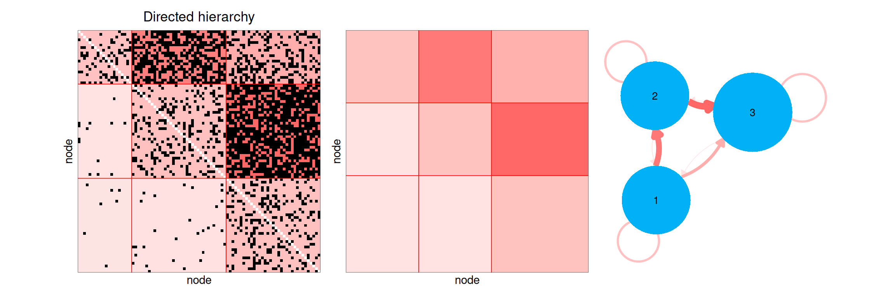
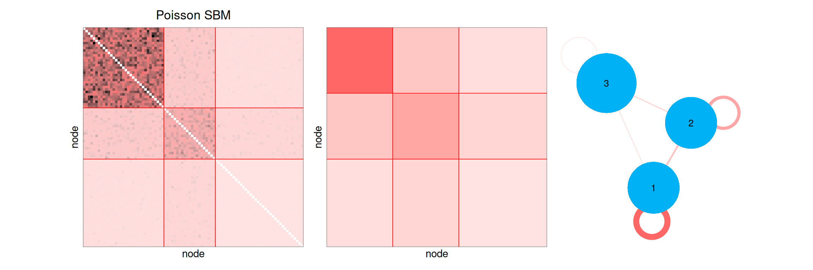
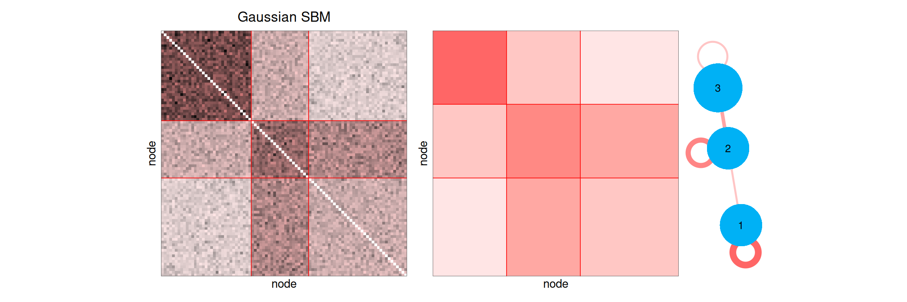
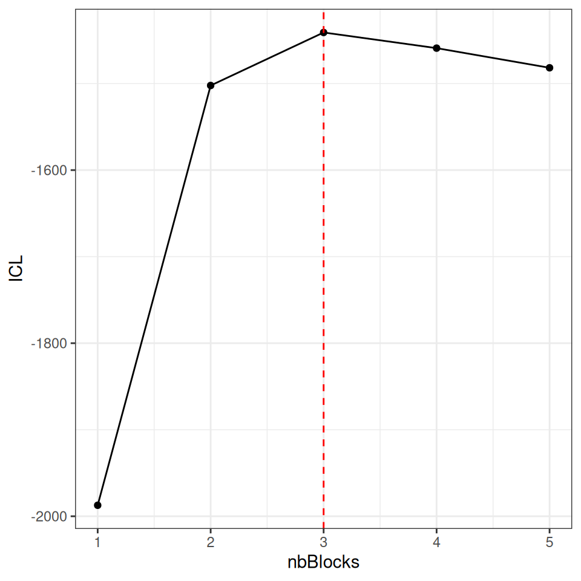

# Stochastic Block Models: principle and illustration

## 1. Introduction

The Stochastic Block Model (SBM) is a probabilistic model for networks,
which assumes that the nodes are divided into a small number of groups
(the *blocks*), the nodes of a same block having the same way of
connecting to the other nodes. It is a flexible model: depending on its
parameters, it can describe networks with communities, a core and a
periphery, a hierarchy, a nested structure… The blocks are not observed:
the aim of the inference is to recover them from the network, together
with the connectivity between the blocks.

This vignette presents:

1.  the simple and bipartite SBM;
2.  a gallery of networks simulated with the package, illustrating the
    variety of structures the SBM can describe;
3.  the inference of the model and the choice of the number of blocks;
4.  the plots provided by the package.

Applications to real data sets are given in the other vignettes.

``` r

library(sbm)
library(ggplot2)
library(patchwork) # to put figures side by side
theme_set(theme_bw())
```

## 2. The Stochastic Block Model

### 2.1 Simple SBM

Consider a network of $`n`$ nodes, described by its adjacency matrix
$`Y = (Y_{ij})_{1 \le i,j \le n}`$, where $`Y_{ij}`$ describes the
relation from node $`i`$ to node $`j`$: presence or absence of an edge
(binary network), number of interactions (count network), intensity of
the relation (weighted network). The network can be directed
($`Y_{ij} \neq Y_{ji}`$) or undirected ($`Y_{ij} = Y_{ji}`$).

> **The simple SBM**
>
> The $`n`$ nodes are divided into $`Q`$ blocks with proportions
> $`\pi = (\pi_1, \dots, \pi_Q)`$. Each node $`i`$ belongs to a latent
> (non observed) block $`Z_i`$ and
> ``` math
> \begin{align*}
>  (Z_i)_{i} \text{ i.i.d.} \qquad & \mathbb{P}(Z_i = q) = \pi_q, \\
>  (Y_{ij})_{i \neq j} \text{ indep.} \mid (Z_i)_{i} \qquad & Y_{ij} \mid Z_i = q, Z_j = l \sim \mathcal{F}(\alpha_{ql}),
> \end{align*}
> ```
> where $`\mathcal{F}`$ is a distribution depending on the type of the
> edges, parametrized by the connectivity $`\alpha_{ql}`$ between blocks
> $`q`$ and $`l`$:
>
> - Bernoulli for binary networks:
>   $`Y_{ij} \mid Z_i = q, Z_j = l \sim \mathcal{B}ern(\alpha_{ql})`$,
>   $`\alpha_{ql}`$ being the probability of connection;
> - Poisson for count networks:
>   $`Y_{ij} \mid Z_i = q, Z_j = l \sim \mathcal{P}(\alpha_{ql})`$,
>   $`\alpha_{ql}`$ being the mean number of interactions;
> - Gaussian for weighted networks:
>   $`Y_{ij} \mid Z_i = q, Z_j = l \sim \mathcal{N}(\alpha_{ql}, \sigma^2)`$,
>   $`\alpha_{ql}`$ being the mean weight.
>
> For an undirected network, $`\alpha_{ql} = \alpha_{lq}`$ and the model
> is defined for $`i < j`$.

The structure of the network is entirely encoded in the connectivity
matrix $`\alpha = (\alpha_{ql})_{q,l}`$, together with the block
proportions $`\pi`$: two nodes of a same block have the same
probabilities to connect to any other node.

### 2.2 Bipartite SBM

A bipartite network links two types of nodes, for instance plants and
pollinators, or trees and fungi. It is described by an incidence matrix
$`Y = (Y_{ij})_{1 \le i \le n_1, 1 \le j \le n_2}`$, where $`Y_{ij}`$
describes the relation between the node $`i`$ of the first type (in row)
and the node $`j`$ of the second type (in column).

> **The bipartite SBM**
>
> The $`n_1`$ row nodes are divided into $`Q_1`$ blocks with proportions
> $`\pi^1`$ and the $`n_2`$ column nodes into $`Q_2`$ blocks with
> proportions $`\pi^2`$:
> ``` math
> \begin{align*}
>  (Z^1_i)_{i} \text{ i.i.d.} \qquad & \mathbb{P}(Z^1_i = q) = \pi^1_q, \\
>  (Z^2_j)_{j} \text{ i.i.d.}, \text{ indep. of } (Z^1_i)_{i} \qquad & \mathbb{P}(Z^2_j = r) = \pi^2_r, \\
>  (Y_{ij})_{i,j} \text{ indep.} \mid (Z^1_i)_{i}, (Z^2_j)_{j} \qquad & Y_{ij} \mid Z^1_i = q, Z^2_j = r \sim \mathcal{F}(\alpha_{qr}),
> \end{align*}
> ```
> with the same distributions $`\mathcal{F}`$ as for the simple SBM.

> **Extensions**
>
> The package also handles:
>
> - covariates on the edges (see the vignette *Simple and Bipartite
>   Stochastic Block Models*);
> - covariates on the nodes, driving the blocks (see the vignette
>   *Stochastic Block Models with covariates on nodes*);
> - multipartite and multiplex networks (see the corresponding
>   vignettes).

## 3. A gallery of network structures

The functions `sampleSimpleSBM` and `sampleBipartiteSBM` simulate
networks from an SBM, given the numbers of nodes, the block proportions
and the connectivity. We use them to illustrate the variety of
structures the SBM can describe. For each network, we show:

- the adjacency matrix, the nodes being ordered by block
  (`type = "data"`);
- the graphon, *i.e.* the connectivity $`\alpha`$, each block being
  represented by an interval whose length is its proportion
  (`type = "graphon"`);
- the mesoscopic view, *i.e.* the graphon drawn as a network: each block
  is a node whose area is proportional to its proportion, and the
  connectivity between two blocks (or within a block, as a loop) is an
  edge whose width and color grow with the connectivity
  (`type = "meso"`).

``` r

showSBM <- function(mySBM, title) {
  (plot(mySBM, type = "data") + ggtitle(title)) |
    plot(mySBM, type = "graphon") |
    plot(mySBM, type = "meso", plotOptions = list(seed = 1))
}
```

### 3.1 Communities

The most classical structure: the nodes are much more connected within
their block than with the other blocks. The connectivity matrix has
large values on its diagonal.

``` r

set.seed(1)
alphaCommunities <- matrix(0.05, 3, 3) + diag(0.5, 3)
alphaCommunities
#>      [,1] [,2] [,3]
#> [1,] 0.55 0.05 0.05
#> [2,] 0.05 0.55 0.05
#> [3,] 0.05 0.05 0.55
communities <- sampleSimpleSBM(nbNodes = 90, blockProp = c(0.4, 0.35, 0.25),
                               connectParam = list(mean = alphaCommunities))
showSBM(communities, "Communities")
```



### 3.2 Core and periphery

A small block of nodes (the core) is connected to all the other nodes,
whereas the nodes of the periphery are mostly connected to the core.

``` r

alphaCore <- matrix(c(0.9, 0.6, 0.3,
                      0.6, 0.2, 0.05,
                      0.3, 0.05, 0.01), 3, 3)
corePeriphery <- sampleSimpleSBM(nbNodes = 90, blockProp = c(0.15, 0.35, 0.5),
                                 connectParam = list(mean = alphaCore))
showSBM(corePeriphery, "Core and periphery")
```



### 3.3 Disassortative structure

The nodes are connected to the nodes of the other block, not to the
nodes of their own block, as in a network of sexual partners or a food
web between predators and preys.

``` r

alphaDisassortative <- matrix(c(0.05, 0.6,
                                0.6, 0.05), 2, 2)
disassortative <- sampleSimpleSBM(nbNodes = 90, blockProp = c(0.5, 0.5),
                                  connectParam = list(mean = alphaDisassortative))
showSBM(disassortative, "Disassortative")
```



### 3.4 Hierarchy in a directed network

In a directed network, $`\alpha_{ql}`$ is the probability of an edge
from a node of block $`q`$ to a node of block $`l`$, and the
connectivity matrix is not symmetric. Here, the edges go mostly from
block 1 to block 2 and from block 2 to block 3: the mesoscopic view
displays the hierarchy with arrows.

``` r

alphaHierarchy <- matrix(c(0.2, 0.6, 0.3,
                           0.02, 0.2, 0.7,
                           0.01, 0.02, 0.2), 3, 3, byrow = TRUE)
hierarchy <- sampleSimpleSBM(nbNodes = 90, blockProp = c(0.3, 0.3, 0.4),
                             connectParam = list(mean = alphaHierarchy),
                             directed = TRUE)
showSBM(hierarchy, "Directed hierarchy")
```



### 3.5 Count and weighted networks

With the Poisson distribution, $`\alpha_{ql}`$ is the mean number of
interactions between a node of block $`q`$ and a node of block $`l`$;
with the Gaussian distribution, it is the mean weight of the relation.
The colors of the plots now represent the counts or the weights.

``` r

alphaPoisson <- matrix(c(8, 2, 0.5,
                         2, 4, 1,
                         0.5, 1, 0.2), 3, 3)
countNetwork <- sampleSimpleSBM(nbNodes = 90, blockProp = c(0.3, 0.3, 0.4),
                                connectParam = list(mean = alphaPoisson),
                                model = "poisson")
showSBM(countNetwork, "Poisson SBM")
```



``` r

alphaGaussian <- matrix(c(4, 1, 0,
                          1, 3, 2,
                          0, 2, 1), 3, 3)
weightedNetwork <- sampleSimpleSBM(nbNodes = 90, blockProp = c(0.3, 0.3, 0.4),
                                   connectParam = list(mean = alphaGaussian, var = 1),
                                   model = "gaussian")
showSBM(weightedNetwork, "Gaussian SBM")
```



### 3.6 Bipartite networks

In a bipartite network, the mesoscopic view draws the blocks of rows (on
top) and the blocks of columns (at the bottom) with different colors. A
*modular* bipartite network is made of groups of rows interacting with
their own group of columns.

``` r

alphaModular <- matrix(c(0.7, 0.05, 0.05,
                         0.05, 0.6, 0.05,
                         0.05, 0.05, 0.8), 3, 3)
modular <- sampleBipartiteSBM(nbNodes = c(60, 90),
                              blockProp = list(row = c(0.3, 0.4, 0.3), col = c(0.3, 0.3, 0.4)),
                              connectParam = list(mean = alphaModular),
                              dimLabels = c(row = "plant", col = "pollinator"))
showSBM(modular, "Modular bipartite network")
```


In a *nested* network, frequently observed in ecology, the specialists
(rows or columns with few interactions) interact with a subset of the
partners of the generalists.

``` r

alphaNested <- matrix(c(0.95, 0.8, 0.5,
                        0.8, 0.4, 0.1,
                        0.5, 0.1, 0.02), 3, 3)
nested <- sampleBipartiteSBM(nbNodes = c(60, 90),
                             blockProp = list(row = c(0.2, 0.3, 0.5), col = c(0.2, 0.3, 0.5)),
                             connectParam = list(mean = alphaNested),
                             dimLabels = c(row = "plant", col = "pollinator"))
showSBM(nested, "Nested bipartite network")
```


## 4. Inference

### 4.1 Estimation and model selection

The blocks and the parameters $`\theta = (\pi, \alpha)`$ are estimated
with a variational EM algorithm ([Leger 2016](#ref-blockmodels)), which
computes an approximation of the distribution of the blocks given the
network, for each number of blocks $`Q`$ in a range explored by the
algorithm. The number of blocks is selected with the Integrated
Classification Likelihood (ICL). For a simple SBM with $`Q`$ blocks, the
ICL computed by the package is
``` math
\mathrm{ICL}(Q) = \mathbb{E}_{Z\sim p^{Var}}[\log \, p(Y, Z; \widehat{\theta})] - \frac{1}{2}\left[ N_\alpha  \, \log \, N_{Y} + (Q-1)\, \log \, n \right],
```
where:

- $`\mathbb{E}_{Z\sim p^{Var}}[\log p(Y, Z; \widehat{\theta})]`$ is the
  complete-data log-likelihood, the latent blocks $`Z`$ being integrated
  against the variational distribution $`p^{Var}`$;
- $`N_\alpha`$ is the number of connectivity parameters: $`Q^2`$ for a
  directed network, $`Q(Q+1)/2`$ for an undirected one (plus one
  variance parameter in the Gaussian case). It is penalized by the
  logarithm of the number of dyads $`N_Y`$: $`n(n-1)`$ for a directed
  network, $`n(n-1)/2`$ for an undirected one;
- $`Q-1`$ is the number of free block proportions, penalized by the
  logarithm of the number of nodes $`n`$.

For a bipartite SBM, the penalty becomes
``` math
N_\alpha \log(n_1 n_2) + (Q_1-1)\log n_1 + (Q_2-1)\log n_2,
```
with $`N_\alpha = Q_1 Q_2`$.

The model with the highest ICL is selected.

### 4.2 Fitting a simulated network

We fit an SBM on the core-periphery network simulated above with
`estimateSimpleSBM`. The network being undirected and binary, we use a
Bernoulli SBM.

``` r

fitCore <- estimateSimpleSBM(corePeriphery$networkData, model = "bernoulli",
                             estimOptions = list(verbosity = 0, plot = FALSE))
```

All the models explored during the estimation are stored in the field
`storedModels`, which gives for each number of blocks the log-likelihood
and the ICL.

``` r

fitCore$storedModels |>
  ggplot() + aes(x = nbBlocks, y = ICL) + geom_line() + geom_point() +
  geom_vline(xintercept = fitCore$nbBlocks, color = "red", linetype = "dashed")
```



The ICL selects 3 blocks, the true number. The estimated blocks are
compared with the true ones with a contingency table and the Adjusted
Rand Index (ARI, equal to $`1`$ for a perfect recovery).

``` r

table(estimated = fitCore$memberships, true = corePeriphery$memberships)
#>          true
#> estimated  1  2  3
#>         1 17  0  0
#>         2  0 25  3
#>         3  0  1 44
aricode::ARI(fitCore$memberships, corePeriphery$memberships)
#> [1] 0.853803
```

The estimated connectivity and block proportions are close to the true
ones, up to a permutation of the blocks:

``` r

round(fitCore$connectParam$mean, 2)
#>      [,1] [,2] [,3]
#> [1,] 0.89 0.61 0.30
#> [2,] 0.61 0.18 0.05
#> [3,] 0.30 0.05 0.01
round(fitCore$blockProp, 2)
#> [1] 0.19 0.32 0.49
```

which can be seen by comparing the true and estimated mesoscopic views.
To compare them, the blocks are placed at the same positions with the
option `layout` (one row of coordinates per block); here, the estimated
blocks have the same numbers as the true ones (see the table above),
otherwise the rows of the layout should be permuted accordingly.

``` r

triangle <- cbind(x = c(0, -1, 1), y = c(1, -0.7, -0.7))
plot(corePeriphery, type = "meso", plotOptions = list(layout = triangle, title = "True")) |
  plot(fitCore, type = "meso", plotOptions = list(layout = triangle, title = "Estimated"))
```


## 5. The plots of the package

The `plot` method is available for the simulated networks and the fitted
models, both for simple and bipartite SBM. Its argument `type` gives the
representation:

| `type` | Representation |
|----|----|
| `"data"` | the adjacency matrix, the nodes being ordered by block (option `ordered = FALSE` to keep the original order). The background of each block is colored according to its mean value |
| `"expected"` | the expected value of each edge under the model |
| `"graphon"` | the connectivity, each block being represented by an interval whose length is its proportion |
| `"meso"` | the mesoscopic view: the graphon drawn as a network |

> **The expected value of each edge**
>
> We call **expected value of each edge** the value
> ``` math
>  \mathbb{E}[Y_{ij}] = \sum_{q=1}^Q\sum_{r=1}^Q \widehat{\tau}^{var}_{iq}\widehat{\tau}^{var}_{jr} \widehat{\alpha}_{qr}
> ```
> where $`\widehat{\tau}^{var}_{iq} = \mathbb{P}(Z_i=q \mid y^{obs})`$
> approximated by the variational inference. This value is obtained by
> `mySimpleSBM$predict()`.

All these plots are `ggplot2` objects, which can be modified or combined
(here with `patchwork`).

``` r

plot(fitCore, type = "data") | plot(fitCore, type = "expected")
```


The plots are customized with the argument `plotOptions` (see
[`?plot.SBM`](https://grosssbm.github.io/sbm/reference/plot.SBM.md) for
all the options). For instance, the names of the nodes are added to the
matrix plots with `rowNames = TRUE` and `colNames = TRUE`. For the
mesoscopic view:

- `withinBlock = "fill"` represents the connectivity within the blocks
  by the color of the blocks instead of loops (for simple SBM only, the
  colors of the blocks distinguishing the types of nodes in bipartite
  SBM);
- `edge.threshold` hides the connectivities below a threshold;
- `seed` fixes the random layout, which can also be given with `layout`;
- `vertex.color`, `vertex.size`, `vertex.label.name` change the colors,
  sizes and labels of the blocks.

``` r

plot(fitCore, type = "meso", plotOptions = list(seed = 1, withinBlock = "fill")) |
  plot(fitCore, type = "meso", plotOptions = list(seed = 1, edge.threshold = 0.1,
                                                  vertex.color = "steelblue"))
```


The matrix and the graphon of any network or connectivity can also be
drawn directly with the functions `plotMyMatrix` and `plotMyGraphon`.

## References

Leger, Jean-Benoist. 2016. “Blockmodels: A r-Package for Estimating in
Latent Block Model and Stochastic Block Model, with Various Probability
Functions, with or Without Covariates.” *arXiv Preprint
arXiv:1602.07587*.
